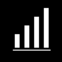
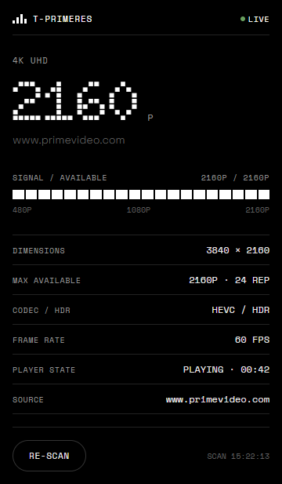
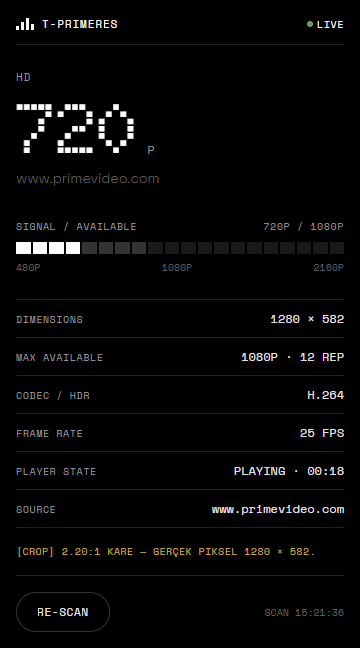
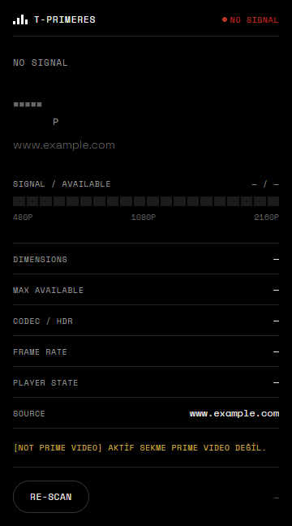

<div align="center">



# T-PrimeRes — Nothing 🎬

**Prime Video oynatıcısının o anki gerçek çözünürlüğü — real-time resolution, one click.** 🚀

Chrome / Brave eklentisi · Toolbar düğmesine bas → popup açılır → tarama otomatik başlar. Ekstra tık yok. ⚡

[](manifest.json)
[](https://github.com/taroxzen/T-PrimeRes/releases)
[](manifest.json)
[](manifest.json)
[](popup/popup.js)
[](popup/popup.html)
[](popup/popup.css)
[](LICENSE)
[](#teknoloji-ve-yapı)
[](#lisans)

📖 [Türkçe](#kurulum-brave--chrome) · [English](#quick-start-en) · 📦 [Releases](#sürümler--releases) · 🔐 [Güvenlik](#güvenlik--security)

</div>

---

## 🖼️ Arayüz / UI Preview 📸

Nothing Design sistemi, koyu mod. Aşağıdaki ekran görüntüleri gerçek Prime Video ölçüm verisiyle alındı (Brave, 21.11.2026). 🧪

| 🎬 4K UHD · HDR | 🎞️ 720p · 2.2:1 crop | ⚠️ NO SIGNAL |
|:---:|:---:|:---:|
|  |  |  |
| `2160P` · HEVC / HDR · 60 FPS | `720P` · 1280 × 582 · [CROP] | `[NOT PRIME VIDEO]` uyarısı |

Doto hero sayı → Space Grotesk metin → Space Mono ALL CAPS label. Gri skala 4 seviye. Kırmızı yalnızca hata; veri durumu yeşil / sarı. 🎨

---

## 🚀 Sürümler / Releases 📦

Tüm sürümler, notlar ve indirilebilir dosyalar: **[github.com/taroxzen/T-PrimeRes/releases](https://github.com/taroxzen/T-PrimeRes/releases)** 🔗

| Sürüm / Version | Tarih / Date | İçerik / Notes | Durum / Status |
|---|---|---|---|
| **v1.0.0** | 21.11.2026 | İlk sürüm: MPD yakalama, `<video>` doğrulama, segment göstergesi, toolbar rozeti, Nothing temalı popup, yerel fontlar. | ✅ Güncel / Latest |
| Kaynak / Source | Sürekli | `manifest.json` · `background/` · `content/` · `popup/` · `fonts/` | 🔓 Açık / Open |

- Etiketler (tags) ve değişiklik kayıtları GitHub Releases üzerinde tutulur. 🏷️
- İndirilen sürümü **Paketlenmemiş öğe yükle** ile doğrudan kullanabilirsiniz. ⬇️
- Repo yayına alındığında üstteki `release` badge'i otomatik güncellenir. 🔄

---

## 📦 Kurulum (Brave / Chrome) 🔧

1. `brave://extensions` adresini aç.
2. Sağ üstten **Geliştirici modu**nu aç. *(Developer mode)*
3. **Paketlenmemiş öğe yükle** → `PrimeRes` klasörünü seç. *(Load unpacked)*
4. Araç çubuğundaki yapboz ikonuna tıkla → T-PrimeRes yanındaki **Sabitle**yi seç. 📌
   - Not: Tarayıcı API'si eklentiyi programatik olarak sabitlemeye izin vermez; bu adım elle yapılır.

## ▶️ Kullanım / Usage 🚀

1. Prime Video'da bir içerik başlat. 🎥
2. Sabitlenen T-PrimeRes düğmesine tıkla. 🖱️
3. Popup otomatik tarar; sonuç hazır gelir. ✅

Düğme üzerindeki rozet de güncel yüksekliği gösterir: 🏷️

| Rozet / Badge | Anlamı / Meaning |
|---|---|
| `4K` | 2160p ve üzeri (yeşil) 🟢 |
| `2K` | 1440p |
| `1080` | Full HD |
| `720` | HD |
| `SD` | 720p altı (sarı) 🟡 |

`RE-SCAN` başlatıldıktan sonra oynatıcıya geçip tekrar denemek için kullanılır. 🔄

## 🔍 Çözünürlük nasıl bulunuyor / How it works 🧠

| Katman / Layer | Yöntem / Method |
|---|---|
| Ana / Primary | Prime Video'un DASH `*.mpd` manifest'i XHR ve `fetch` üzerinden yakalanır; video `Representation` değerlerinden `width/height`, codec, FPS ve HDR okunur. |
| Doğrulama / Verify | `<video>.videoWidth / videoHeight` — o an çözülen gerçek kare boyutu. |
| Kurtarma / Fallback | Manifest yakalanamadıysa `performance.getEntriesByType("resource")` içindeki `.mpd` URL'leri yeniden okunur. |

Eklenti yalnızca `primevideo.com` ve manifest'te listelenen `amazon` alan adlarında çalışır. Veri toplamaz; MPD dışında ağ isteği yapmaz. 🔒

Sinema filmleri 2.2:1 kırpılmış kareyle gelir (ör. `1280 × 582`). Bu durumda hero sayı, genişlikten nominal sınıfı geri çıkarır (`720`), `DIMENSIONS` satırı gerçek pikseli gösterir ve `[CROP]` notu eklenir. 🎞️

---

## 🔐 Güvenlik / Security 🛡️

**Kısa cevap: Evet, güvenli.** Eklenti yalnızca Prime Video sekmesinde çözünürlük okur; veri toplamaz, dışarıya göndermez, hesabınıza erişmez. Kaynak kod tamamen açık ve denetlenebilir. ✅

### 🔑 İzinler / Permissions — neden gerekli?

| İzin / Permission | Neden kullanılır / Why |
|---|---|
| `activeTab` | Kullanıcı düğmeye bastığında aktif sekmenin adresini okumak için. |
| `tabs` | Aktif sekmenin URL'sini `chrome.tabs.query` ile almak için. Tüm sekmelerin geçmişi okunmaz. |
| `scripting` | İçerik betiklerinin Prime Video sayfasında çalışması için bildirildi. |
| `host_permissions` | Yalnızca `primevideo.com` ve listedeki 17 `amazon.*` alan adı. Başka siteye enjekte edilmez. |

> Not: Eklenti **kurulum sırasında** geçmiş, çerez, şifre veya konum izni istemez. Bunlara dair hiçbir izin yok. 🚫

### 📡 Ağ trafiği / Network

- Eklentinin kendi sunucusu yok. Analitik, telemetri, reklam veya raporlama çağrısı yok. 📴
- Tek olası ek istek: sayfanın zaten yüklediği `.mpd` DASH manifestinin yeniden okunması (manifest yakalanamadığında). Bu istek `credentials: "omit"` ile yapılır — çerez gönderilmez, oturum bilgisi taşınmaz. 🍪🚫
- Video, ses veya kişisel veri indirilmez; yalnızca MPD'deki `width/height`, codec, FPS ve HDR alanları okunur. 📄

### 🧠 Veri işleme / Data handling

- Ölçüm değerleri **yalnızca bellekte** tutulur (sayfa açıkken). `localStorage`, `sessionStorage`, `chrome.storage` kullanılmaz. 💾🚫
- Giriş bilgisi, ödeme bilgisi, arama geçmişi, konum, ekran görüntüsü veya tuş kaydı alınmaz. 🔒
- Popup ve rozet sadece sayı, codec ve alan adı gösterir. Hiçbir şey kaydedilmez, hiçbir yere gönderilmez. 👁️

### 🧱 Kod ve yalıtım / Code & isolation

- **Açık kaynak:** GPL-3.0. Build adımı, minify/obfuscation yok. Kaynak kodu olduğu gibi okuyabilirsiniz. 🔍
- **Uzak kod yok:** `eval`, `new Function`, `importScripts`, `sendBeacon`, WebSocket veya CDN betiği yok. Manifest V3 CSP kurallarına uyar. 🚫
- **İki katman:** `probe.js` sayfanın MAIN world'ünde sadece MPD ve `<video>` okur; `bridge.js` izole world'de mesaj taşır. `event.source !== window` kontrolü ve özel `__primeres_v1__` etiketiyle filtrelenir. 🧩
- **Yerel fontlar:** Doto / Space Grotesk / Space Mono paketin içinde; Google Fonts'a canlı bağlantı yok. 🔤

### ✅ Kendiniz doğrulayın / Verify it yourself

1. `manifest.json`, `background/`, `content/`, `popup/` dosyalarını okuyun — kod küçük ve sade. 📖
2. Brave → `brave://extensions` → eklentiyi yükleyin; **Site erişimi** ve izinleri görün. ⚙️
3. Geliştirici araçları → **Network** sekmesi: MPD dışında eklentiden çıkan isteğe bakın. 🌐
4. **Sources** sekmesinde uzaktan yüklenen betik olmadığını kontrol edin. 🔬

**Güvenli olduğunu iddia etmiyoruz, kanıtlıyoruz.** Kaynak açık, izinler sınırlı, ağ trafiği tek ve şeffaf. 🛡️

📄 Ayrıntılı politika ve özel bildirim: [`SECURITY.md`](SECURITY.md) · [Wiki → Güvenlik](https://github.com/taroxzen/T-PrimeRes/wiki/G%C3%BCvenlik)

---

## 🛠️ Teknoloji ve yapı / Tech stack 💻

| Teknoloji | Kullanım yeri |
|---|---|
| **JavaScript** (ES6+, framework yok) | MV3 service worker, `MAIN` world probe, izole world bridge, popup mantığı |
| **HTML5** | Popup arayüzü (`popup/popup.html`) |
| **CSS3** | Nothing temalı koyu tasarım, segment göstergesi, rozet durumları |
| **Chrome Extensions API** | `tabs`, `scripting`, `activeTab`, toolbar badge |
| **Yerel fontlar** | Doto 700, Space Grotesk 300/400/500, Space Mono 400/700 (TTF) |

Build adımı yok, paket bağımlılığı yok, canlı CDN bağlantısı yok. Saf JS + HTML + CSS. 🪶

```text
PrimeRes/
├── manifest.json             MV3 tanımı
├── background/service-worker.js toolbar rozeti
├── content/probe.js          MAIN world: MPD + video ölçümü
├── content/bridge.js         izole world: mesaj köprüsü
├── popup/                    Nothing temalı arayüz
├── screenshots/              README ekran görüntüleri
├── fonts/                    Doto, Space Grotesk, Space Mono (yerel)
└── icons/                    16 / 48 / 128 px
```

## ✅ Doğrulama / Verified (Brave, 21.11.2026) 🧪

Gerçek Prime Video oturumunda, oynatma sırasında ölçülen değerler:

| Alan / Field | Sonuç / Result |
|---|---|
| Video karesi | `1280 × 582` |
| Nominal sınıf | `720P / HD` (2.2:1 kırpma) |
| MPD maksimum | `1920 × 872` → `1080P` |
| Representation | 12 (video) + 54 (ses) |
| Codec / FPS | H.264 (`avc1`), 25 FPS, HDR yok |
| Düşen kare / Dropped frames | 0 🎯 |

Popup, segment göstergesi ve rozet mantığı bu veriyle görsel olarak kontrol edildi. 👁️

## 🩹 Sorun giderme / Troubleshooting ⚠️

| Belirti / Symptom | Çözüm / Fix |
|---|---|
| `[NO BRIDGE]` | Prime Video sekmesini yenile, eklentiyi `brave://extensions` sayfasından yeniden yükle. |
| `[NO MPD]` | Oynatıcıyı başlat, birkaç saniye bekle, `RE-SCAN` yap. |
| Rozet görünmüyor | Eklentiyi araç çubuğuna sabitle. 📌 |
| `— / —` | Video henüz yüklenmemiş; oynatmayı başlat. |

## 🌐 Quick start (EN) 🇬🇧

1. Open `brave://extensions` → enable **Developer mode**.
2. Click **Load unpacked** → select the `PrimeRes` folder.
3. Pin T-PrimeRes to the toolbar. 📌
4. Play a title on Prime Video → click the pinned button.
5. Popup scans automatically and shows the real playback resolution. ✅

No tracking. No external requests beyond the DASH manifest. GPL-3.0. 🔒

## 📄 Lisans / License

GPL-3.0. Detaylar: [`LICENSE`](LICENSE). Telif: Taroxzen, 2026. ✍️
